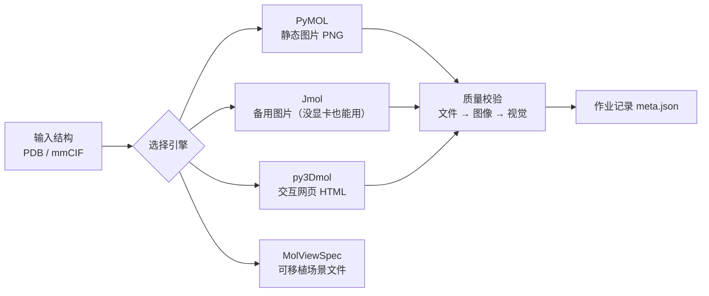
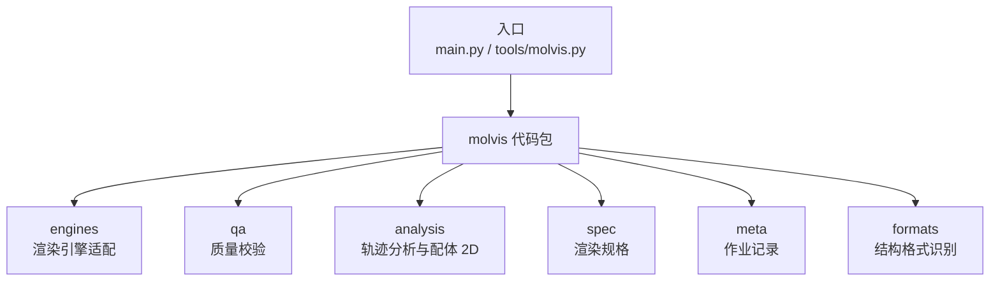

# 分子可视化工具包（visualization_software_toolkit）

**一句话**：给一个分子结构文件，它就能生成结构图片、可交互的网页，还能对分子动力学轨迹做分析和出图。

- **开箱即用**：依赖已装好、示例数据已就绪，无需手动配置
- **不会白跑**：一种出图方式不可用时会自动换用另一种
- **有据可查**：每次运行都会做“体检”，并留下一份可复现的作业记录

## 它能做什么

| 你想做的事 | 它会给你 |
|---|---|
| 渲染一个结构（如 1ubq） | 一张静态结构图（PNG）＋ 一个可旋转缩放的网页（HTML） |
| 换个样式看看 | 卡通 / 表面 / 棍状 / 配体口袋 四种风格 |
| 分析一条分子动力学轨迹 | RMSD、RMSF 曲线图 ＋ 几个“关键时刻”的结构图 |
| 查看复合物里的配体 | 一张化学结构式（2D）图 |
| 交给程序自动调用 | 一段结构化 JSON 结果 ＋ 一份作业记录 |

## 工作流程



出图失败会自动改走备用引擎，不会静默失败。

## 代码结构一览



## 我该用哪个命令

| 想做什么 | 用这个命令 |
|---|---|
| 检查环境是否正常 | `main.py check` |
| 快速看一遍所有效果 | `main.py demo` |
| 渲染某个结构 | `main.py render <结构>` |
| 分析一条轨迹 | `main.py traj <拓扑> <轨迹>` |
| 画配体 2D 结构式 | `main.py ligand <结构>` |
| 让程序自动调用 | `tools/molvis.py <结构>`（输出 JSON） |

## 快速开始（三种方式任选）

**方式 1：双击启动**
```
双击  启动.bat      →  自动执行“环境自检 + 一键演示”
```

**方式 2：命令行**
```bat
.venv\Scripts\python.exe main.py                              :: 不带参数：显示帮助
.venv\Scripts\python.exe main.py check                        :: 仅环境自检
.venv\Scripts\python.exe main.py demo                         :: 一键演示
.venv\Scripts\python.exe main.py render 1hsg                  :: 渲染结构（PDB ID / data 文件名 / 文件路径）
.venv\Scripts\python.exe main.py render 1hsg --style ligand    :: 样式：cartoon / surface / sticks / ligand
.venv\Scripts\python.exe main.py render 1hsg --engine both     :: 引擎：pymol / jmol / both
.venv\Scripts\python.exe main.py render 1hsg --width 800 --height 600   :: 自定义图片大小
.venv\Scripts\python.exe main.py traj data\1ubq.pdb data\1ubq_traj.dcd  :: 轨迹分析
.venv\Scripts\python.exe main.py ligand 1hsg                   :: 配体 2D 结构式
```

**方式 3：自检与测试**
```bat
.venv\Scripts\python.exe tools\verify_install.py      :: 环境、版本与产物清单
.venv\Scripts\python.exe -m pytest tests              :: 运行测试（离线，不触发真实出图）
.venv\Scripts\python.exe tools\molvis.py 1hsg         :: 工具契约：输出结构化 JSON
```

## 目录结构

```
visualization_software_toolkit\
├─ main.py                   # 统一入口
├─ molvis\                   # 代码包（核心实现）
│  ├─ config.py              #   路径与常量
│  ├─ utils.py               #   小工具
│  ├─ formats.py             #   结构格式识别（PDB / mmCIF）
│  ├─ spec.py                #   渲染规格（风格 / 画布 / 期望）
│  ├─ meta.py                #   作业记录 meta.json
│  ├─ api.py                 #   程序调用接口
│  ├─ check.py               #   环境自检
│  ├─ demo.py                #   一键演示
│  ├─ render.py              #   单结构渲染
│  ├─ cli.py                 #   命令行入口
│  ├─ qa\                    #   质量校验（文件 / 图像 / 视觉）
│  ├─ analysis\              #   轨迹分析与配体 2D
│  └─ engines\               #   各渲染引擎适配
├─ 启动.bat                  # 双击启动器
├─ requirements.txt          # 运行依赖
├─ requirements-lock.txt     # 依赖版本锁定
├─ requirements-dev.txt      # 开发 / 测试依赖
├─ data\                     # 示例数据（1ubq / 1hsg / 合成轨迹）
├─ tests\                    # 测试
├─ tools\                    # verify_install.py / molvis.py
└─ outputs\                  # 运行产物（含 demo\ 演示结果）
```

## 演示产物（`outputs\demo\`）

| 文件 | 说明 |
|---|---|
| `1ubq_pymol.png` | PyMOL 卡通图 |
| `1hsg_ligand_pymol.png` | 配体口袋视角 |
| `1ubq_jmol.png` | Jmol 备用渲染图（纯软件渲染） |
| `1ubq_interactive.html` / `1hsg_ligand.html` | 可旋转、缩放的网页 |
| `scripts\*.py`、`meta.json`、`*.mvsj` | 渲染脚本、作业记录与场景文件（本机生成） |

轨迹分析与配体 2D 的产物分别在 `outputs\traj_<轨迹名>\` 与 `outputs\ligand_<结构名>\` 下。

## 质量校验与作业记录

- `--qa` 三档：`0` 关闭；`1`（默认）检查文件与图像；`2` 再加一层“看图判断”的视觉校验。任何一档发现异常，都会以非零退出码报告。
- 视觉校验需要一个外部视觉模型，用环境变量 `MOLVIS_VISION_BASE_URL` / `MOLVIS_VISION_API_KEY` / `MOLVIS_VISION_MODEL` 配置；没配就自动跳过，不影响离线使用。
- 每次运行都会在对应目录写一份 `meta.json`，记录输入与产物、用到的引擎与版本、校验结果和耗时，方便复现。

## 注意事项

- **运行环境**：Windows 桌面会话；PyMOL 出图需要已登录的桌面；Jmol 是纯软件渲染，没有显卡也能用，但需要系统装有 Java。
- **联网点**：`render <PDB ID>` 首次会从 RCSB 下载结构；离线使用请先把结构文件放进 `data\`。
- **PyMOL 说明**：官方 Windows 安装包缺少运行库，这里使用的是社区完整构建版（非官方，仅供测试评估）。
- **许可**：本项目采用 **PolyForm Noncommercial 1.0.0** —— 仅限非商业使用，并附带免责声明（详见 `LICENSE`，含中文摘要与英文原文；中文仅为便于理解，以英文原文为准）。第三方组件各自遵循其原有许可：PyMOL 开源版为 BSD 风格许可、Jmol 为 LGPL-2.0、MDAnalysis 为 GPL-2.0+。
- **发布范围**：本仓库只发布代码、本篇说明文档、许可文件、示例数据与演示产物；内部文档目录、独立软件包与虚拟环境不随仓库发布。
